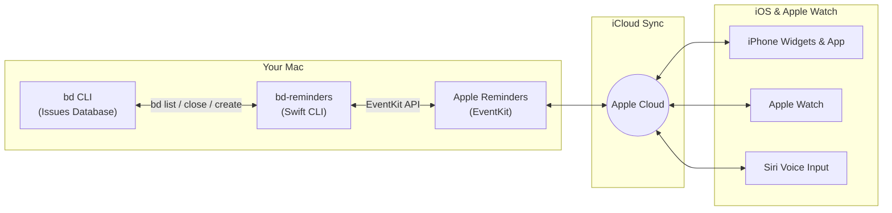

# bd-reminders

[](https://swift.org)
[](https://apple.com/macos)
[](https://github.com)
[](LICENSE)

Two-way synchronization between **[Beads (`bd`)](https://github.com/stevekuznetsov/beads)** developer issue tracking and **Apple Reminders**, giving you seamless task management across **Mac, iPhone, iPad, and Apple Watch** via iCloud.

Written in pure Swift 6 using macOS `EventKit`. Zero external dependencies.

---

## Why bd-reminders?

**Beads (`bd`)** is a powerful, git-backed/Dolt-backed CLI issue tracker built for developers and autonomous coding agents. However, when you step away from your terminal:
- You cannot easily check what tasks are pending from your iPhone.
- You cannot glance at tasks on your Apple Watch or iOS Lock Screen widgets.
- You cannot quickly capture thoughts with Siri while on the go.

**`bd-reminders` bridges this gap.** It synchronizes your terminal-based Beads issues with a native Apple Reminders list, syncing in real-time over iCloud.

---

## How It Works



### Bidirectional Sync Loop

1. **Beads $\rightarrow$ iPhone:**
   - All `open` and `in_progress` issues are synced to your designated list in Apple Reminders.
   - P0–P4 priorities map automatically to Reminders' priority flags (High `!!!`, Medium `!!`, Low `!`).
   - Descriptions, notes, issue types, and statuses are stored in the reminder's notes.
   - Closing an issue on your Mac (`bd close <id>`) marks the reminder completed.

2. **iPhone $\rightarrow$ Beads:**
   - **Checking off a reminder** on your iPhone, iPad, or Apple Watch automatically closes the issue in Beads (`bd close <id> --reason "Completed via Apple Reminders"`).
   - **Adding a reminder on iPhone or via Siri** (e.g., *"Add task to MyProject: test offline caching"*) automatically registers a new issue in Beads (`bd create`) and updates the reminder with its new ID (`[proj-xxxx]`).

---

## Requirements

- **Operating System:** macOS 14.0 (Sonoma) or newer.
- **Swift:** Swift 6.0+ (included with Xcode 16+ or Command Line Tools).
- **Beads:** [`bd`](https://github.com/stevekuznetsov/beads) installed on your system.
- **Permissions:** Full Reminders access granted to Terminal / your shell in **System Settings $\rightarrow$ Privacy & Security $\rightarrow$ Reminders**.

---

## Installation

### Clone & Build (Recommended)

```bash
git clone https://github.com/<your-username>/bd-reminders.git
cd bd-reminders
make install
```

This compiles an optimized release binary with strict concurrency checks enabled and installs it to:
```
~/.local/bin/bd-reminders
```

Ensure `~/.local/bin` is in your shell's `$PATH` (in `~/.zshrc`):
```bash
export PATH="$HOME/.local/bin:$PATH"
```

To verify installation:
```bash
bd-reminders --help
```

---

## Usage

### 1. Default Sync (Current Directory)
Run `bd-reminders` inside any Beads-tracked project:
```bash
cd ~/Sites/my-project
bd-reminders
```
By default, `bd-reminders` matches the target Reminders list name to your project's folder name (case-insensitive):
- Folder `my-app` $\rightarrow$ Reminders list **"My-App"** (or **"my-app"**).
- Folder `backend` $\rightarrow$ Reminders list **"Backend"**.

### 2. Custom Project Path or List Name
```bash
# Sync a specific project from anywhere
bd-reminders -p ~/Projects/my-project

# Sync into a custom Reminders list
bd-reminders -l "Agent Backlog"

# Combine both
bd-reminders -p ~/Projects/my-project -l "Work Tasks"
```

### 3. Dry-Run Mode
Inspect what operations *would* be performed without modifying Beads or Reminders:
```bash
bd-reminders --dry-run
```

---

## CLI Reference

| Flag | Short | Description | Default |
| :--- | :---: | :--- | :--- |
| `--project <path>` | `-p` | Path to the Beads project directory | Current directory (`.`) |
| `--list <name>` | `-l` | Name of the target Apple Reminders list | Current folder name |
| `--dry-run` | | Preview changes without writing | `false` |
| `--help` | `-h` | Display usage instructions | |

---

## Automation Recipes

### Quick Shell Alias
Add a handy alias to `~/.zshrc`:
```bash
alias bdsync="bd-reminders"
```

### Git Post-Commit Hook
Automatically sync reminders after every commit by adding this to your project's `.git/hooks/post-commit`:
```bash
#!/usr/bin/env bash
if command -v bd-reminders &> /dev/null; then
    bd-reminders > /dev/null 2>&1 &
fi
```

### Automated Background Sync (macOS launchd)
To run sync every 15 minutes in the background, create `~/Library/LaunchAgents/com.user.bdreminders.plist`:
```xml
<?xml version="1.0" encoding="UTF-8"?>
<!DOCTYPE plist PUBLIC "-//Apple//DTD PLIST 1.0//EN" "http://www.apple.com/DTDs/PropertyList-1.0.dtd">
<plist version="1.0">
<dict>
    <key>Label</key>
    <string>com.user.bdreminders</string>
    <key>ProgramArguments</key>
    <array>
        <string>/Users/your-username/.local/bin/bd-reminders</string>
        <string>-p</string>
        <string>/Users/your-username/Projects/my-project</string>
    </array>
    <key>StartInterval</key>
    <integer>900</integer>
    <key>RunAtLoad</key>
    <true/>
</dict>
</plist>
```
Load the agent with:
```bash
launchctl load ~/Library/LaunchAgents/com.user.bdreminders.plist
```

---

## Development & Testing

This project is built using modern Swift 6 with Swift Package Manager and strict concurrency checking.

```bash
# Run unit tests
swift test

# Build debug binary
swift build

# Build release binary
make release

# Clean build artifacts
make clean
```

### Test Suite
The test suite in [`Tests/BdRemindersCoreTests/SyncLogicTests.swift`](Tests/BdRemindersCoreTests/SyncLogicTests.swift) validates:
- Regex extraction for bracketed and unbracketed bead IDs (`[proj-xxxx]` and `proj-xxxx`).
- Priority conversions between Beads and EventKit.
- `bd` JSON output parsing with trailing CLI envelope notes.
- Automatic list name resolution from directory paths.

---

## License

This project is released under the [MIT License](LICENSE).
